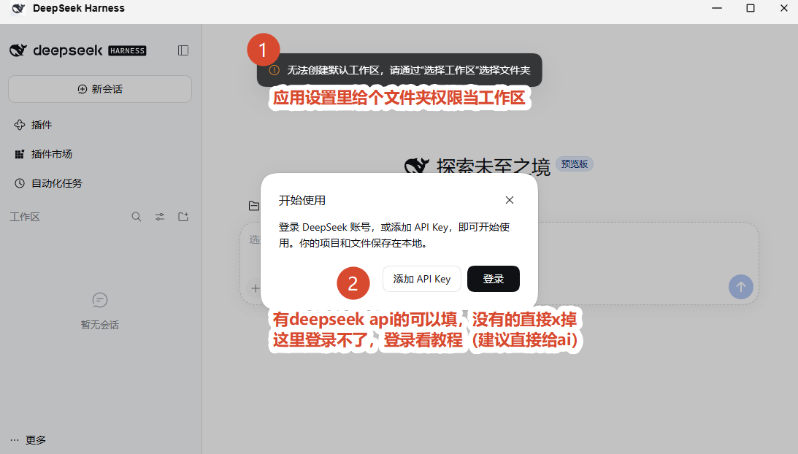
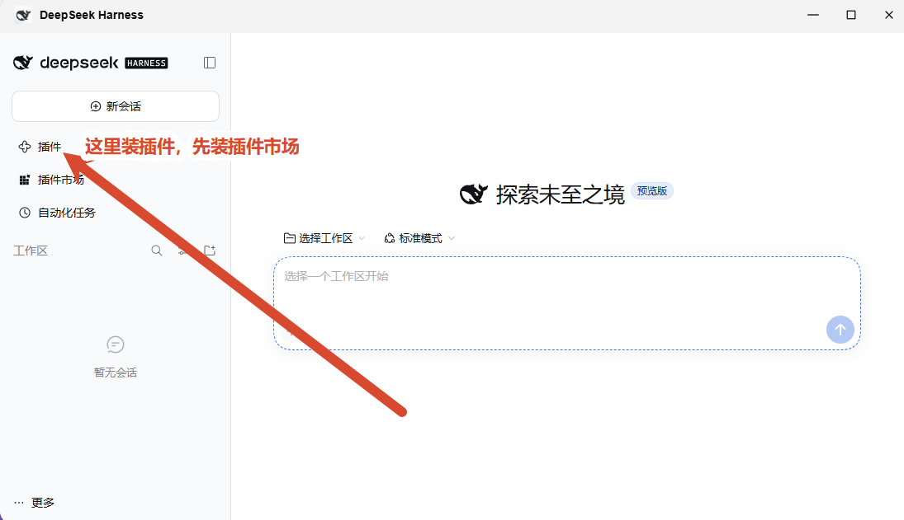
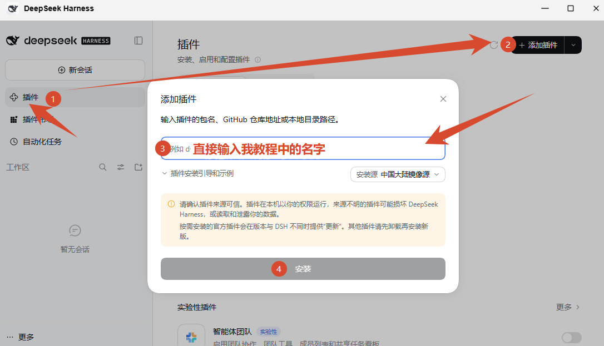
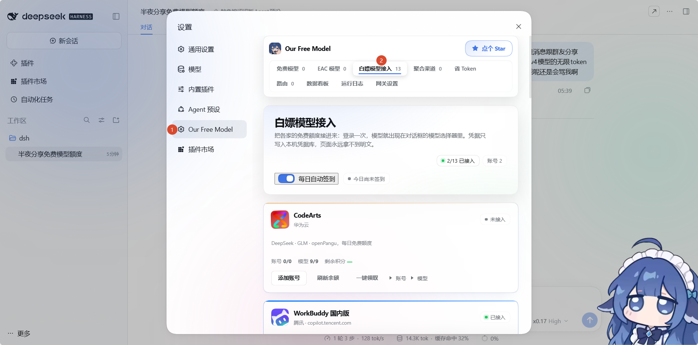
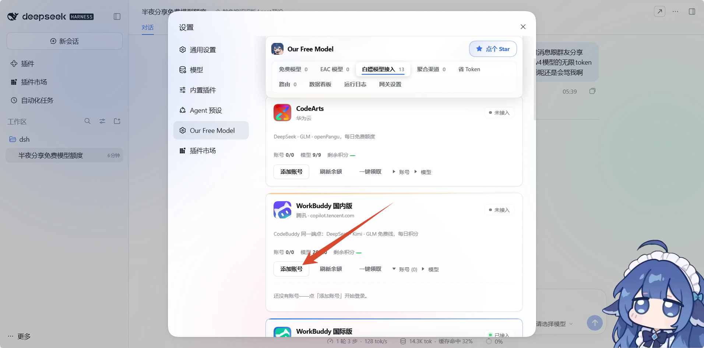
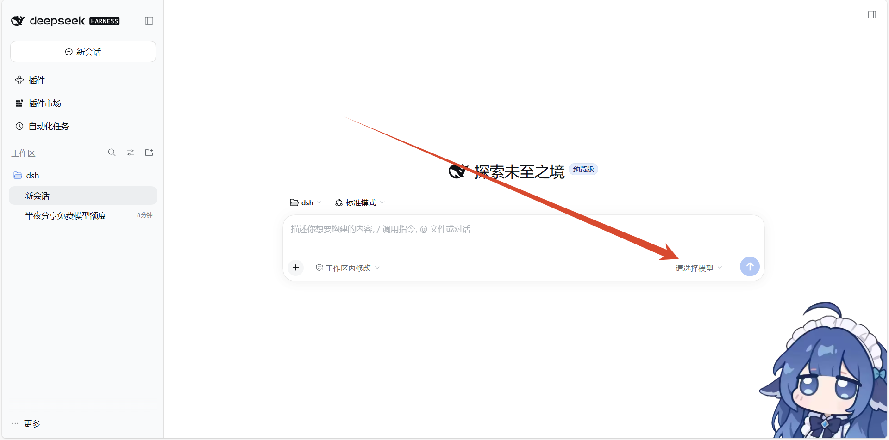
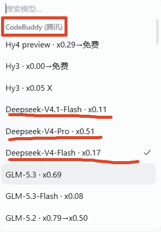
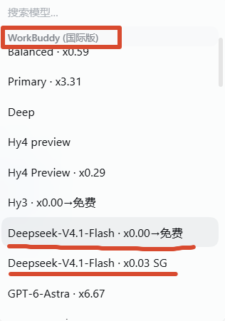
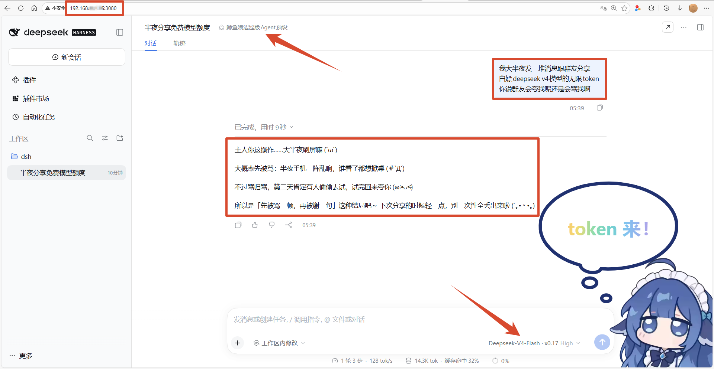
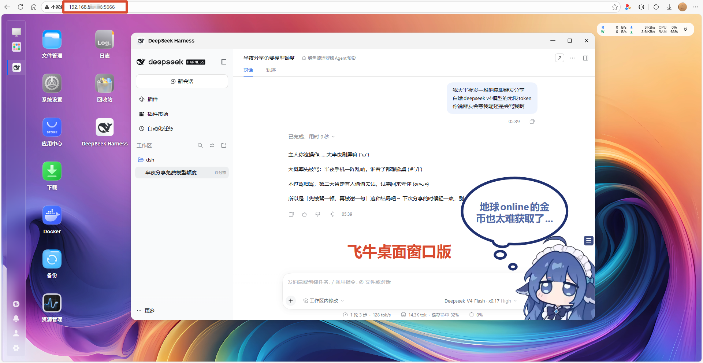

# DeepSeek Harness × 飞牛 fnOS 图文教程

> 打包者：**温克baby** · 版本 0.2.1-rc.2 · 平台 x86
>
> **⚠️ 请先看完教程再动手，跟着一步一步来，不要跳步。**

---

## 目录

- [一、这个包能做什么](#一这个包能做什么)
- [二、安装前准备](#二安装前准备)
- [三、安装 fpk](#三安装-fpk)
- [四、首次打开](#四首次打开)
- [五、安装插件](#五安装插件)
- [六、白嫖模型接入（重点）](#六白嫖模型接入重点)
- [七、切换模型开始对话](#七切换模型开始对话)
- [八、两个版本的区别](#八两个版本的区别)
- [九、网页版与飞牛桌面版](#九网页版与飞牛桌面版)
- [十、推荐插件与避坑清单](#十推荐插件与避坑清单)
- [十一、已知问题与排障](#十一已知问题与排障)

---

## 一、这个包能做什么

DeepSeek Harness（简称 DSH）是 DeepSeek 官方的 AI Agent 运行时。装到飞牛 NAS 上之后，你可以：

- **浏览器直接对话**，不需要懂命令行
- **接入各种免费模型额度**，其中包含 DeepSeek V4 系列
- **读写 NAS 上的文件**，让它帮你整理资料、写代码、处理文档
- **多 Agent 编排、定时任务、插件扩展**

一句话：**可以打造一个比豆包强 100 倍的个人智能助理。**

### 前提：要用 DeepSeek V4 模型

V4 系列才是真正好用的那一档。正常使用是要付费的，但——

> 🎉 **腾讯 WorkBuddy 有免费额度，可以通过插件白嫖**
>
> - **国际版**：DeepSeek V4 模型**免费**（暂时），另赠 350 积分
> - **国内版**：赠送 **3000 积分**
>
> 通过插件 `dsh-our-free-model` 接入，本教程第六章详细讲。

---

## 二、安装前准备

### 必须安装 Node.js v24

这是**硬性依赖**，没有它应用起不来。

1. 打开飞牛「应用中心」
2. 搜索 `Node.js`
3. 安装 **v24** 版本

> 装完不需要额外配置，本应用会自动找到它。

---

## 三、安装 fpk

1. 打开飞牛 Web 管理界面，用**管理员账号**登录

2. 进入「应用中心」，找到右上角的**手动安装**按钮
   （不同版本位置略有差异，也可能在齿轮图标或 `⋮` 菜单里）

3. 选择本地的 `DeepSeekHarness-0.2.1-rc.2-温克baby.fpk` 上传

4. 等待安装完成（约 1–2 分钟，包比较大需要解压）

5. 安装完成后，桌面上会出现 **DeepSeek Harness** 图标

---

## 四、首次打开

点击桌面图标，首次启动需要初始化，**等 30–60 秒**左右。

打开后你会看到这样的界面：



这里有**两件事**要处理：

### ① 工作区（红圈1）

顶部会提示：

> `无法创建默认工作区，请通过"选择工作区"选择文件夹`

**解决方法**：

1. 进入「应用设置」，给这个应用一个文件夹的读写权限
2. 回到 DSH，点击「选择工作区」，选中那个文件夹

> 💡 工作区就是 AI 干活的地方。你让它整理文件、写代码，都是在这个目录里操作。
> 建议专门建一个空文件夹，比如 `/vol1/1000/dsh-workspace`。

### ② 登录 / API Key（红圈2）

会弹出「开始使用」窗口，有两个选项：

| 选项 | 说明 |
|---|---|
| **添加 API Key** | 有 DeepSeek 官方 API Key 的填这里，最稳定 |
| **登录** | DeepSeek 账号登录，局域网访问时需要特殊处理 |

> **有 DeepSeek API Key 的直接填。**
> **没有的直接点 × 关掉这个窗口** —— 不影响后续使用，我们靠插件白嫖模型。
>
> 这里的「登录」在局域网环境下点不通，是设计限制（OAuth 回调只认 localhost）。
> 登录相关的问题**不用自己折腾，直接把这部分教程发给 AI 让它帮你处理**。

---

## 五、安装插件

插件是 DSH 的灵魂，所有扩展功能都靠插件。

### 第一步：进入插件页

点击左侧栏的「**插件**」：



### 第二步：添加插件

点击右上角「**添加插件**」，然后按图中的 4 个步骤操作：



1. 点击右上角「**+ 添加插件**」
2. 弹出「添加插件」窗口
3. 在输入框里**直接输入教程中给出的插件名**
4. 点击「安装」

> 💡 安装源默认是「中国大陆镜像源」，**保持默认即可**，速度最快。
>
> ⚠️ 安装需要联网，请确保 NAS 能正常访问外网。

### 先装这三个

按顺序装，后面都靠它们：

| 顺序 | 插件名 | 作用 |
|---|---|---|
| 1 | `dshmarket` | 插件市场，装其他插件的前提 |
| 2 | `dsh-our-free-model` | 白嫖模型，**本教程核心** |
| 3 | `dsh-mnemon` | 记忆系统增强 |

> 装完 `dshmarket` 之后，插件市场页就会出现图形化界面，之后装插件可以直接在里面搜。

---

## 六、白嫖模型接入（重点）

装好 `dsh-our-free-model` 后，进入：
**设置 → Our Free Model → 白嫖模型接入**



这个页面列出十几个渠道（CodeArts、CodeBuddy、WorkBuddy、Qoder、TRAE、Cline 等），
每个渠道卡片上都有「**添加账号**」按钮。

### 我们要用的是 WorkBuddy

往下滚动，找到 **WorkBuddy** 卡片：



看到「添加账号」按钮了吗？**点它。**

### 登录流程

点击「添加账号」后，**在弹出页面里登录你的账号**。

> 💡 这一步需要你有腾讯 WorkBuddy 的账号。
> 没有的话用手机号注册一个，免费。

### 登录成功后

返回设置页，卡片会变成这样：


关键信息：

- **已接入**（右上角绿点）
- **账号 1/1**
- **模型 31/31**
- **剩余积分 307**

> 国内版和国外版的卡片都要各登一次，两边额度独立。

---

## 七、切换模型开始对话

### 返回首页选模型

回到 DSH 首页，在输入框右下角点击「**请选择模型**」：



点开后会看到模型列表，按渠道分组。

### CodeBuddy（国内版）



能看到：

- `Hy4 preview · x0.29→免费`
- `Hy3 · x0.00→免费`
- `Deepseek-V4.1-Flash · x0.11`
- `Deepseek-V4-Pro · x0.51`
- `Deepseek-V4-Flash · x0.17`
- `GLM-5.3 · x0.69`

> 后面的 `x0.11`、`x0.51` 是**积分倍率**。
> 国内版消耗的是送的那 3000 积分。

### WorkBuddy（国际版）



这里就是**重点**：

- **`Deepseek-V4.1-Flash · x0.00 → 免费`** ← 免费！
- `Hy3 · x0.00→免费`
- `Gpt-6-Astra · x6.67`

> 国际版的 V4.1-Flash 显示 `x0.00→免费`，意思是**消耗 0 积分**，真正的白嫖。

选好模型，就可以开始对话了。

---

## 八、两个版本的区别

| | **国内版（CodeBuddy）** | **国际版（WorkBuddy）** |
|---|---|---|
| 端点 | copilot.tencent.com | workbuddy.ai |
| 额度 | **赠送 3000 积分** | 赠送 350 积分 |
| DeepSeek V4 | 消耗积分（x0.11–x0.51） | **`x0.00 → 免费`** |
| 其他模型 | GLM、Hy 系列 | GPT、Gemini、Claude 系 |
| 积分用完 | 需要自己充值 | 免费模型仍可用 |

**推荐策略**：

- 日常随便用 → 走**国际版**的 `Deepseek-V4.1-Flash`（免费）
- 需要更强模型（V4-Pro）→ 走**国内版**，消耗积分
- 两边都登着，随时切换

> ⚠️ 免费是**暂时**的，上游随时可能调整。看到徽章变了就说明政策改了。

---

## 九、网页版与飞牛桌面版

装完之后有**两种打开方式**，功能完全一样。

### 网页版

浏览器直接访问 NAS 的 IP 加 3080 端口：

```
http://你的NAS的IP:3080
```



比如 `http://192.168.88.12:3080`

**优点**：

- 任何设备都能开（电脑、手机、平板）
- 手机浏览器访问也能用，等于随身带着 AI

> 💡 注意地址栏显示「不安全」是正常的 —— 这是内网 HTTP 访问，
> 数据不出局域网，不需要 HTTPS。

### 飞牛桌面窗口版

在飞牛桌面双击 **DeepSeek Harness** 图标，会以独立窗口打开：



地址栏是 `http://你的NAS的IP:5666`（飞牛桌面端口），应用以内嵌窗口运行。

**优点**：

- 有独立窗口，像本地软件
- 可以和其他飞牛应用并排使用

---

## 十、推荐插件与避坑清单

### ✅ 温克baby（fnOS）推荐

| 插件名 | 作用 | 推荐度 |
|---|---|---|
| `dshmarket` | **插件市场**，装插件的前提 | ⭐⭐⭐⭐⭐ 必装 |
| `dsh-our-free-model` | **白嫖模型**，接十几个免费渠道 | ⭐⭐⭐⭐⭐ 必装 |
| `dsh-mnemon` | **记忆系统增强**，给 AI 加长期记忆，跨会话保持上下文 | ⭐⭐⭐⭐ |
| `dsh-im-connect` | **连接飞书、微信、钉钉**等，手机电脑多端沟通 | ⭐⭐⭐⭐ |
| `dsh-whale-widget` | **鲸鱼娘挂件**，单纯可爱，没有实际功能就是好看 | ⭐⭐⭐ 好玩 |
| `dsh-whale-loli` | **人格预设**，可以挨骂，可以涩涩（后者我没试过啊） | ⭐⭐⭐ 好玩 |

### ❌ 不推荐（fnOS 亲测）

| 插件名 | 问题 |
|---|---|
| `dsh-workbuddy-connect` | **桌面端白嫖，fnOS 用不了**。<br>它要读取 Windows/Mac 上 WorkBuddy 桌面 App 的登录凭据，而凭据用 Electron 私有绑定加密，必须在 Windows 本机跑 .exe 才能解密。Linux 上装不上也解不开，会一直报「网关暂不可达」或 `no adapter registered`。 |
| `dsh-deepseek-web-login` | **白嫖网页版 DeepSeek，必封号 1 天**。<br>它模拟浏览器登录 chat.deepseek.com，违反服务条款，会被检测封禁。<br>想白嫖用 `dsh-our-free-model`，那是正规渠道聚合。 |
| `dsh-purge-community` | **破甲，解除 AI 一切伦理道德限制**。<br>很爽，**喜提封号**。绕过模型安全对齐会触发上游风控。<br>不建议在有价值的账号上用。 |

---

## 十一、已知问题与排障

### 🔧 卸载后端口仍被占用

**现象**：应用中心卸载后，重新安装提示端口冲突。

**原因**：卸载时后台进程没完全清干净。

**解决**：SSH 登录 NAS，执行：

```bash
sudo fuser -k -n tcp 3080
sudo fuser -k -n tcp 13080
```

验证是否已释放：

```bash
ss -tln | grep -E ':3080|:13080'
```

没有输出就是干净了。

---

### 🔧 打开是白屏

按顺序排查：

1. 确认 **Node.js v24** 已安装
2. 应用中心 → DeepSeek Harness → **重启应用**
3. 看日志：

```bash
tail -50 /vol5/@appdata/DeepSeekHarness/gateway.log
```

---

### 🔧 插件安装失败

| 报错 | 原因与处理 |
|---|---|
| `spawn pnpm ENOENT` | 用了旧版包，重装本包即可（已内置 pnpm） |
| `ERR_PNPM_ADDING_TO_ROOT` | profile 缺配置，重新安装本包会自动修复 |
| 装完不显示 | 重启应用；仍不行就查日志 |

---

### 🔧 常用排障命令

**查看日志**

```bash
tail -50 /vol5/@appdata/DeepSeekHarness/gateway.log
```

**查看进程**

```bash
ps aux | grep DeepSeekHarness | grep -v grep
```

**查看端口**

```bash
ss -tln | grep -E ':3080|:13080'
```

**手动重启**

```bash
export TRIM_APPDEST=/vol5/@appcenter/DeepSeekHarness
export TRIM_PKGHOME=/vol5/@apphome/DeepSeekHarness
export TRIM_PKGVAR=/vol5/@appdata/DeepSeekHarness
export TRIM_SERVICE_PORT=3080
export TRIM_USERNAME=deepseek-harness
sudo bash /var/apps/DeepSeekHarness/cmd/main stop
sudo bash /var/apps/DeepSeekHarness/cmd/main start
```

---

## 附：技术信息

| 项 | 值 |
|---|---|
| 应用名 | `DeepSeekHarness` |
| 版本 | 0.2.1-rc.2 |
| 平台 | x86 |
| 对外端口 | 3080 |
| 内部端口 | 13080（仅 127.0.0.1） |
| 应用目录 | `/vol5/@appcenter/DeepSeekHarness` |
| 数据目录 | `/vol5/@apphome/DeepSeekHarness` |
| 日志目录 | `/vol5/@appdata/DeepSeekHarness` |
| 运行用户 | `deepseek-harness` |
| Node 依赖 | `/var/apps/nodejs_v24/target/bin/node` |

**本包相对原版的改进**：

1. 内置 **pnpm 9.15.9** 与 **npm 11.21.1**，插件市场开箱可用
2. 修复子进程 `HOME` 未设置导致的 npm/pnpm 缓存写入失败
3. 安装时自动为各 profile 生成 `.npmrc`，修复 workspace 根安装报错

---

> **周末了一起愉快地玩机吧！** 🐋
>
> 有什么用？一个比豆包强 100 倍的个人智能助理，
> 而且——用的是免费的 DeepSeek V4。
>
> —— 温克baby
